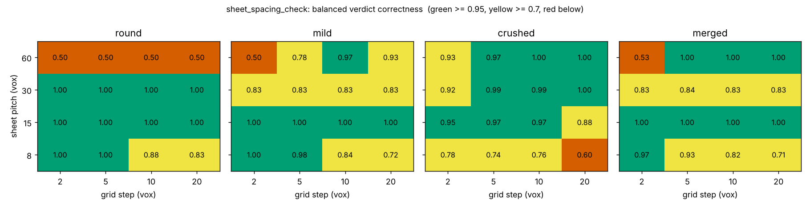
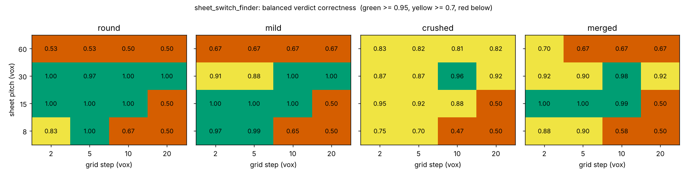
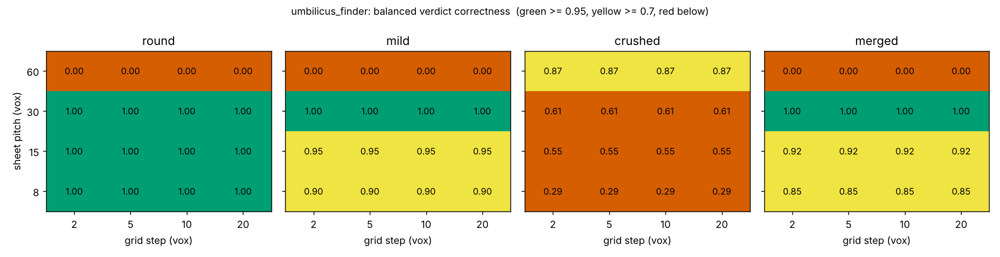
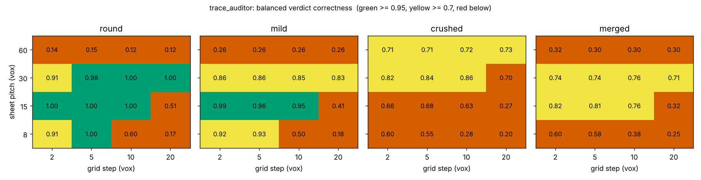
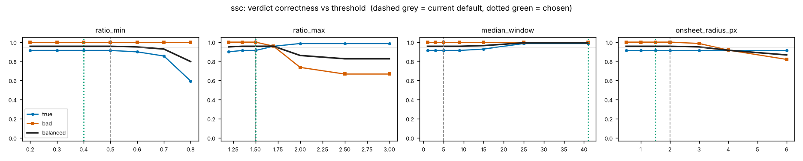
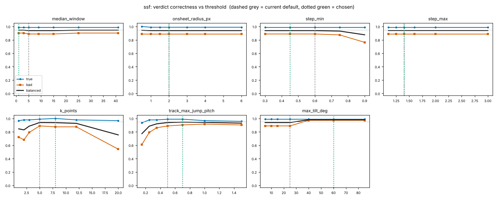
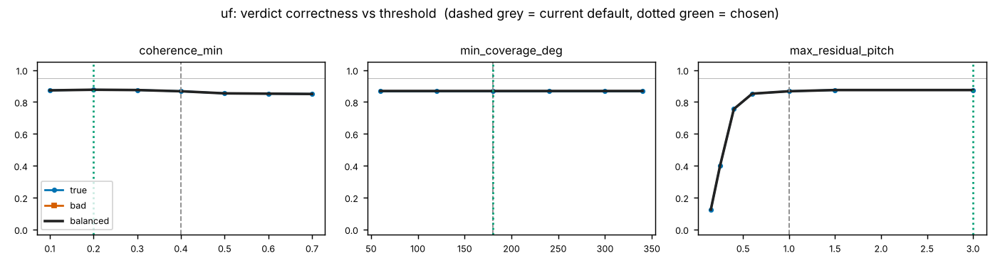
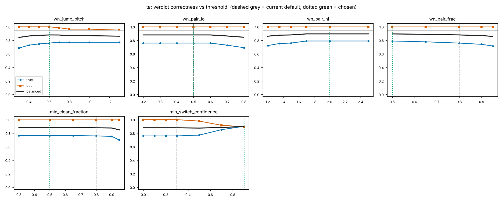

# Operating range of the trace-checking tools

Measured on `phantom_scroll` phantoms (synthetic, exact truth). **Not** a statement about real scrolls: a region marked reliable here is a necessary condition, not evidence of success on scan data. Everything below is regenerated by `tools/calibration/report.py` from `tools/calibration/results/*.csv`; the hand-written commentary is `docs/calibration/commentary.md`.

## 0. Summary and how to read it

**Headline.** Each tool has a reliable band (>= 0.95 balanced correctness) and it is narrow: mostly sheet pitch 15 to 30 voxels and
grid step 2 to 10 voxels. Round and mild sheets are reliable inside that band for most tools; crushed and merged sheets are reliable
only for `sheet_spacing_check` and, for merged at pitch 15, `sheet_switch_finder`. `trace_auditor` (end to end) is below 0.95 for
crushed and merged sheets everywhere. The exact numbers are in `tools/calibration/results/grid_summary.csv`; the per-tool
statements below are read off that table.

- **sheet_spacing_check**: reliable at pitch 15 for round, mild and merged at every grid step, and for crushed at steps 2 to 10 (0.95
  to 0.97; 0.88 at step 20). At pitch 30 it is reliable for round at every step and for crushed at steps 5 to 20 (0.99 to 1.00), but
  sits at 0.83 for mild and merged. Pitch 8 degrades with grid step (round 1.00 at steps 2 and 5, 0.83 at step 20; crushed 0.60 to
  0.78 at every step; merged 0.97 at step 2 down to 0.71 at step 20). At pitch 60 only the first one or two sheets exist at 192^3,
  so treat 0.50 (round) to 1.00 (crushed, merged at steps 5 to 20) as untested, not as a measured limit.
- **sheet_switch_finder**: reliable at pitch 15 for round, mild and merged at steps 2 to 10 (merged 0.99 at step 10), and at pitch 30
  for round at all steps (0.97 to 1.00); at pitch 8 only for round at step 5 (0.83 at step 2) and mild at steps 2 and 5 (0.97, 0.99). Grid step 20 scores
  exactly 0.50 at pitches 8 and 15 for every deformation, i.e. true traces pass and no planted switch is found. Cause not
  investigated; a plausible one is that the 20 voxel grid leaves too few points per cut line, which this study did not test.
  Crushed sheets give 0.87 to 0.96 at steps 2 to 10 for pitches 15 and 30. Pitch 60: 0.50 to 0.83.
- **umbilicus_finder**: reliable on round phantoms at pitch 8 to 30 and on mild at pitch 15 to 30. Crushed phantoms are the failure
  (0.29 at pitch 8, 0.55 at pitch 15, 0.61 at pitch 30); at pitch 15 about half the slices are flagged OK and those are 3 to 7
  voxels off against a tolerance of 3.75. **Pitch 60 round, mild and merged score 0.00 because every slice is flagged LOW** (the
  pitch could not be estimated). The smoothed centre there is still only about 3.6 voxels off for round: the tool declined to
  answer, it did not answer wrongly. The correctness rule counts a decline as wrong when the raw estimate was within tolerance,
  because the auditor then has no centre line; read it as a usability failure, not a localisation failure.
- **trace_auditor** (centre estimated by umbilicus_finder, end to end): reliable for round at pitch 8 (step 5 only), pitch 15 (steps
  2 to 10) and pitch 30 (steps 5 to 20), and for mild at pitch 15 (steps 2 to 10). For crushed and merged phantoms its best cell is
  0.86. Whether the shortfall comes from the estimated centre or from the checks themselves was **not separated**: the grid ran with the
  estimated centre only (`--auditor-centre truth` exists but was not run on the grid).

**What this does and does not show.** The phantoms are smooth idealisations with exact truth. These numbers say where a tool *can*
fail; they do not show it works on scan data. The grid at 192^3 only tests sheets that fit: pitch 60 tests the first one or two sheets
(`valid_frac` column), and the base sheet of the pair tests changes from 1 to 0 at pitch >= 30 (see the README).

## 0.1 Sweeps (section 2): which thresholds matter

Run on 24 phantoms only (seeds 0 to 2, pitch 15 and 30, grid step 5, all deformations), auditor sweeps with the TRUE centre line.
The seeds are a subset of the grid's seeds; **there is no held-out set**, so a chosen value is tuned to these phantoms and is a
proposal, not a validated setting. Flat curves mean the threshold does not matter on these phantoms (not that it does not matter).

- **Flat** (the best value found gains less than 0.005 over the default; the plateau contains the default): sheet_spacing_check
  `ratio_min`, `ratio_max`, `onsheet_radius_px`; sheet_switch_finder `step_min` (plateau 0.3 to 0.75), `step_max`,
  `onsheet_radius_px`; umbilicus `min_coverage_deg`; auditor `wn_jump_pitch` (plateau 0.5 to 0.7), `wn_pair_lo`, `min_clean_fraction`.
- **Sensitive**: sheet_switch_finder `max_tilt_deg` (balanced 0.94 at the default 25, 0.98 from 40 up: planted-switch recall 0.89 ->
  0.97 with true traces unchanged at about 0.99); `k_points` (best at 5 to 12, 0.83 to 0.85 at 1 to 2, 0.76 at 20);
  `track_max_jump_pitch` (0.77 at 0.15, 0.89 at 0.25, 0.94 at 0.5 and above); sheet_spacing_check `median_window` (0.957 at 5, 0.993
  from 25 to 41, so the chosen value is at the edge of the range swept). Auditor `wn_pair_hi`, `wn_pair_frac` and
  `min_switch_confidence` gain 0.015 to 0.02 each; the best `min_switch_confidence` (0.9) is the edge of the range swept. Why a
  stricter confidence helps was not investigated; it needs a wider sweep and real data before anyone trusts it.
- Choices that land on the edge of the swept range are flagged in `results/proposed_defaults.md`.

## 1. Grid

20 seeds x grid step 2, 5, 10, 20 vox x sheet pitch 8, 15, 30, 60 vox x deformation round, mild, crushed, merged; volume 192^3; 29784 rows in `tools/calibration/results/grid.csv`. Cell value = balanced verdict correctness over all seeds (see the module docstring of `calib.py` for what correct means per tool). Classes: **reliable** >= 0.95, **degraded** 0.7 to 0.95, **fails** < 0.7. Sheets that fall mostly outside the volume (valid cells < 30%) are not tested, so pitch 60 at 192^3 only tests the first one or two sheets (`valid_frac` column).

### sheet_spacing_check

- round, **reliable**: pitch 8: steps 2, 5; pitch 15: steps 2, 5, 10, 20; pitch 30: steps 2, 5, 10, 20
- round, **degraded**: pitch 8: steps 10, 20
- round, **fails**: pitch 60: steps 2, 5, 10, 20
- mild, **reliable**: pitch 8: steps 2, 5; pitch 15: steps 2, 5, 10, 20; pitch 60: steps 10
- mild, **degraded**: pitch 8: steps 10, 20; pitch 30: steps 2, 5, 10, 20; pitch 60: steps 5, 20
- mild, **fails**: pitch 60: steps 2
- crushed, **reliable**: pitch 15: steps 2, 5, 10; pitch 30: steps 5, 10, 20; pitch 60: steps 5, 10, 20
- crushed, **degraded**: pitch 8: steps 2, 5, 10; pitch 15: steps 20; pitch 30: steps 2; pitch 60: steps 2
- crushed, **fails**: pitch 8: steps 20
- merged, **reliable**: pitch 8: steps 2; pitch 15: steps 2, 5, 10, 20; pitch 60: steps 5, 10, 20
- merged, **degraded**: pitch 8: steps 5, 10, 20; pitch 30: steps 2, 5, 10, 20
- merged, **fails**: pitch 60: steps 2

### sheet_switch_finder

- round, **reliable**: pitch 8: steps 5; pitch 15: steps 2, 5, 10; pitch 30: steps 2, 5, 10, 20
- round, **degraded**: pitch 8: steps 2
- round, **fails**: pitch 8: steps 10, 20; pitch 15: steps 20; pitch 60: steps 2, 5, 10, 20
- mild, **reliable**: pitch 8: steps 2, 5; pitch 15: steps 2, 5, 10; pitch 30: steps 10, 20
- mild, **degraded**: pitch 30: steps 2, 5
- mild, **fails**: pitch 8: steps 10, 20; pitch 15: steps 20; pitch 60: steps 2, 5, 10, 20
- crushed, **reliable**: pitch 30: steps 10
- crushed, **degraded**: pitch 8: steps 2, 5; pitch 15: steps 2, 5, 10; pitch 30: steps 2, 5, 20; pitch 60: steps 2, 5, 10, 20
- crushed, **fails**: pitch 8: steps 10, 20; pitch 15: steps 20
- merged, **reliable**: pitch 15: steps 2, 5, 10; pitch 30: steps 10
- merged, **degraded**: pitch 8: steps 2, 5; pitch 30: steps 2, 5, 20; pitch 60: steps 2
- merged, **fails**: pitch 8: steps 10, 20; pitch 15: steps 20; pitch 60: steps 5, 10, 20

### umbilicus_finder

- round, **reliable**: pitch 8: any step; pitch 15: any step; pitch 30: any step
- round, **fails**: pitch 60: any step
- mild, **reliable**: pitch 30: any step
- mild, **degraded**: pitch 8: any step; pitch 15: any step
- mild, **fails**: pitch 60: any step
- crushed, **degraded**: pitch 60: any step
- crushed, **fails**: pitch 8: any step; pitch 15: any step; pitch 30: any step
- merged, **reliable**: pitch 30: any step
- merged, **degraded**: pitch 8: any step; pitch 15: any step
- merged, **fails**: pitch 60: any step

### trace_auditor

- round, **reliable**: pitch 8: steps 5; pitch 15: steps 2, 5, 10; pitch 30: steps 5, 10, 20
- round, **degraded**: pitch 8: steps 2; pitch 30: steps 2
- round, **fails**: pitch 8: steps 10, 20; pitch 15: steps 20; pitch 60: steps 2, 5, 10, 20
- mild, **reliable**: pitch 15: steps 2, 5, 10
- mild, **degraded**: pitch 8: steps 2, 5; pitch 30: steps 2, 5, 10, 20
- mild, **fails**: pitch 8: steps 10, 20; pitch 15: steps 20; pitch 60: steps 2, 5, 10, 20
- crushed, **degraded**: pitch 30: steps 2, 5, 10; pitch 60: steps 2, 5, 10, 20
- crushed, **fails**: pitch 8: steps 2, 5, 10, 20; pitch 15: steps 2, 5, 10, 20; pitch 30: steps 20
- merged, **degraded**: pitch 15: steps 2, 5, 10; pitch 30: steps 2, 5, 10, 20
- merged, **fails**: pitch 8: steps 2, 5, 10, 20; pitch 15: steps 20; pitch 60: steps 2, 5, 10, 20

## 2. Threshold sweeps

One threshold varied at a time, others at their defaults, fixed phantoms (`sweep_thresholds.py`). `true` = share of correct verdicts on true traces (false alarms are the rest), `bad` = on the planted-fault traces (misses are the rest), balanced = their mean. Chosen = the value whose own score and both neighbours' scores are best (a plateau, not a spike); ties go to the value nearest the default. Plateau = the contiguous range around the chosen value within 0.01 of its score. **No default was changed.**

### sheet_spacing_check

| threshold | default | balanced at default | chosen | balanced at chosen | plateau | true / bad at chosen |
|---|---|---|---|---|---|---|
| `ratio_min` | 0.5 | 0.957 | 0.4 | 0.957 | 0.2 to 0.6 | 0.91 / 1.00 |
| `ratio_max` | 1.5 | 0.957 | 1.5 | 0.957 | 1.2 to 1.7 | 0.91 / 1.00 |
| `median_window` | 5 | 0.957 | 41 | 0.993 | 25 to 41 | 0.99 / 1.00 |
| `onsheet_radius_px` | 2 | 0.957 | 1.5 | 0.957 | 0.5 to 3 | 0.91 / 1.00 |

### sheet_switch_finder

| threshold | default | balanced at default | chosen | balanced at chosen | plateau | true / bad at chosen |
|---|---|---|---|---|---|---|
| `step_min` | 0.6 | 0.939 | 0.45 | 0.939 | 0.3 to 0.75 | 0.99 / 0.89 |
| `step_max` | 1.4 | 0.939 | 1.4 | 0.939 | 1.1 to 3 | 0.99 / 0.89 |
| `k_points` | 5 | 0.939 | 8 | 0.938 | 5 to 8 | 1.00 / 0.88 |
| `median_window` | 5 | 0.939 | 1 | 0.946 | 1 to 41 | 0.99 / 0.90 |
| `onsheet_radius_px` | 2 | 0.939 | 2 | 0.939 | 0.5 to 6 | 0.99 / 0.89 |
| `track_max_jump_pitch` | 0.5 | 0.939 | 0.7 | 0.946 | 0.5 to 1 | 0.99 / 0.90 |
| `max_tilt_deg` | 25 | 0.939 | 60 | 0.981 | 40 to 85 | 0.99 / 0.97 |

### umbilicus_finder

| threshold | default | balanced at default | chosen | balanced at chosen | plateau | true / bad at chosen |
|---|---|---|---|---|---|---|
| `coherence_min` | 0.4 | 0.867 | 0.2 | 0.877 | 0.1 to 0.4 | 0.88 / nan |
| `min_coverage_deg` | 180 | 0.867 | 180 | 0.867 | 60 to 340 | 0.87 / nan |
| `max_residual_pitch` | 1 | 0.867 | 3 | 0.875 | 1 to 3 | 0.88 / nan |

### trace_auditor

| threshold | default | balanced at default | chosen | balanced at chosen | plateau | true / bad at chosen |
|---|---|---|---|---|---|---|
| `wn_jump_pitch` | 0.6 | 0.880 | 0.6 | 0.880 | 0.5 to 0.7 | 0.76 / 1.00 |
| `wn_pair_lo` | 0.5 | 0.880 | 0.5 | 0.880 | 0.2 to 0.6 | 0.76 / 1.00 |
| `wn_pair_hi` | 1.5 | 0.880 | 2 | 0.895 | 1.7 to 2.5 | 0.79 / 1.00 |
| `wn_pair_frac` | 0.8 | 0.880 | 0.5 | 0.895 | 0.5 to 0.65 | 0.79 / 1.00 |
| `min_clean_fraction` | 0.8 | 0.880 | 0.5 | 0.883 | 0.3 to 0.9 | 0.77 / 1.00 |
| `min_switch_confidence` | 0.3 | 0.880 | 0.9 | 0.899 | 0.9 to 0.9 | 0.90 / 0.90 |
